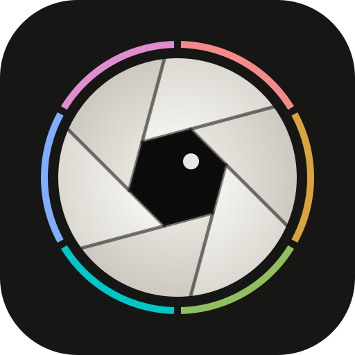

# heimdall


a watchman for your context switches. heimdall keeps the day's tasks, takes a tick every time you switch to one, and draws you a map of where your attention actually went.

because a paper notebook can count the ticks, but it can't tell you that tuesday was 41 switches and a headache.

## the idea

every morning you build the day's board. you carry over what's still open from yesterday, pull in long-running tasks, and add new ones. through the day, you tap whatever you just switched to. that's the whole ritual.

heimdall turns the taps into a ribbon of your day. it counts the switches, keeps deadlines in sight right when you're about to jump to something else, and lets you jot down how the day felt: stress, strain, headaches, whether you cried or laughed. over weeks, the two sit next to each other, so you can see what's been wearing you down.

it nudges, it never scolds. there are no streaks to break and no red failure states, and every number is compared with your own usual days, never with somebody else's idea of normal.

## what counts as a switch

multitasking is the hard part of a notebook. when you bounce between two things fast enough, ticking every bounce is silly, and ticking once is a lie. heimdall's answer:

- **focus** is what you're holding right now. one task, a few tasks, rest, or nothing at all.
- **tap** a task to make it your focus. **hold** a task to add it to what you're already holding. holding two or more is a **juggle**. hold a task that's already in the juggle to **let go** of it.
- **rest** is a break. it's not a failure, and coming back to the same thing afterwards is a resume, not a switch. **end the day** when you're done, so tomorrow starts clean.
- a **switch** is a moment something new enters your head. bouncing inside a juggle isn't counted bounce by bounce. it shows up as juggle time instead, which is its own kind of strain.
- a **tick** is still the notebook's unit. a task gets one every time it comes into focus, including when you pick it back up after a break.

| you go from | to | is it a switch? |
| ----------- | -- | --------------- |
| a | b | yes |
| a | a and b | yes, b came in |
| a and b | b | no, you only let go of a |
| a | rest, then a | no, you came back |
| a | rest, then b | yes, once |

a day starts at 04:00, not midnight, so a switch at 01:30 still belongs to the day you were actually living. the hour is a setting.

right after a switch, heimdall asks why for a few seconds: **done**, **blocked**, **urge**, or **pulled**. answering is optional, and over time it separates your own impulses from the interruptions around you.

## features

- **today.** the board, a live ribbon of the day, the current focus with its timer, tallies in groups of five, and a gentle note when you're about to leave something that's due soon.
- **planning.** an open-the-day sheet with yesterday's leftovers and long-running tasks one tap away, deadlines, manual order, and a backlog for everything else.
- **fixing the past.** forgot to tick at 14:00? log it there. tapped the wrong thing? void it. every count re-derives from what you actually did.
- **history.** swipe back day by day. every switch, every reason, every task's time.
- **week, month, year.** seven ribbons stacked on one hour scale, a calendar shaded by switching with headache, crying, and laughing marked, and a year as a heatmap of any metric.
- **insights.** switching against your own usual range, when and why you switch, focus stretches, juggling, deadline pressure, strain next to switching, and a short list of what stands out. patterns, not causes.
- **check-in.** about 30 seconds, every question optional, built from the research below.
- **offline first.** install it to your home screen. taps land in local storage within a frame, with or without a network, and sync to your other devices when they can.
- **keyboard.** `1` to `9` switch, `shift` plus a number juggles, `r` rests, and every screen has a key.

## the check-in

the core six take one tap each: stress, mental strain, mood, sleep quality, headache (none, mild, moderate, severe), and whether you could switch off from work in the evening. crying and laughing sit right next to them. energy, sleep hours, exercise, time outdoors, social contact, caffeine, meds, and a free note fold away under "more".

the items lean on validated instruments where they exist: single-item stress measures, the exhaustion side of the oldenburg and copenhagen burnout inventories, the consensus sleep diary, headache diary severity scales, and sonnentag and fritz's work on psychological detachment. the one-question versions are adaptations, so heimdall only ever compares you with yourself.

heimdall is not a medical tool. headaches that are new, severe, or frequent are worth raising with a clinician.

## running it

everything you need lives in the dev shell.

```sh
nix develop          # or let direnv do it

cd web && bun install
bun run dev          # the app on http://localhost:5173, fully usable offline
bun run test:unit    # domain, sync, and helpers
bun run check        # svelte-check and the service worker types
bun run build        # the static app the server serves from web/build

cargo run -- --data-dir ./data --web-dir web/build \
  --password-hash-file ./hash --insecure-cookies   # the sync server

lock-web             # regenerate web/.bun.nix after changing web dependencies
nix flake check      # rust tests, clippy, fmt, web types and tests, the package
```

make the password hash with `cargo run -- hash-password < password-file > hash`, or `heimdall hash-password` once installed. it reads the password on stdin.

## deploying

the flake exports `packages.<system>.heimdall`, the server with the web app baked in, and a nixos module.

```nix
{
  inputs.heimdall.url = "github:GustavoWidman/heimdall";

  # in a host's modules
  imports = [ inputs.heimdall.nixosModules.default ];

  services.heimdall = {
    enable = true;
    listen = "127.0.0.1:7979";
    passwordHashFile = config.age.secrets.heimdall-hash.path;
  };

  services.caddy.virtualHosts."heimdall.example.com".extraConfig = ''
    reverse_proxy 127.0.0.1:7979
  '';
}
```

| option | default | description |
| ------ | ------- | ----------- |
| `enable` | `false` | run the sync server and serve the web app |
| `package` | this flake's `heimdall` | the server, with the web app it serves |
| `listen` | `127.0.0.1:7979` | address and port to bind |
| `dataDir` | `/var/lib/heimdall` | where the sqlite database lives |
| `passwordHashFile` | none | an argon2id hash from `heimdall hash-password` |

the unit runs as a dynamic user with a hardened sandbox, and the module has a vm test (`checks.x86_64-linux.heimdall-module`).

## how it works

heimdall is local first. every tap becomes a small change record with a hybrid logical clock, written to indexeddb before the next paint. the record stores what you did (a tap, a hold, a rest), never a computed result, so switches, ticks, and juggle time are derived from your gestures by one pure state machine. fix a past tick and everything after it re-derives. change what counts as a switch and all of history follows, with no migration.

each record field is a last-writer-wins register, so two devices that edited offline merge to the same result in any order. the rust server is a dumb, durable relay. it stores each change byte for byte, hands them back by cursor, pokes open devices over server-sent events, and never learns a single rule about switching.

```text
.
├── flake.nix            # entry point. dev shell, packages, checks, nixos module
├── nix/                 # package, module, dev shell, toolchain
├── src/                 # the rust sync server (axum, sqlite)
├── contract/            # the wire format, shared by both test suites
└── web/                 # the sveltekit app
    └── src/lib/
        ├── domain/      # the rules: switching, days, stats, check-in fields
        ├── replica/     # generic sync: change records, merge, indexeddb, the sync loop
        ├── app/         # the one module screens talk to
        └── ui/          # design tokens and shared components
```

## license

MIT
